<p align="center">
  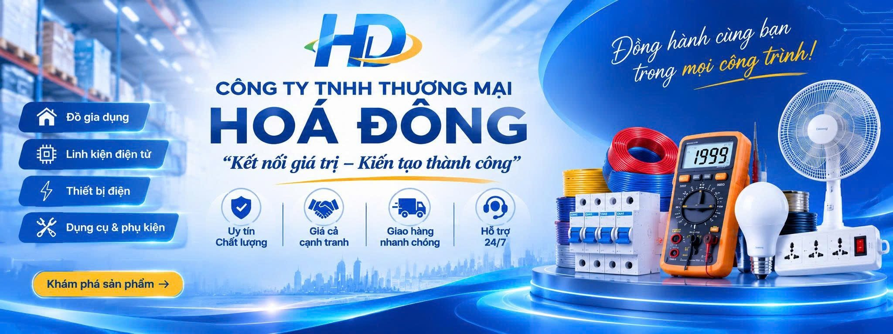
</p>

<h1 align="center">Website Công ty TNHH Thương mại Hoá Đông</h1>

<p align="center">
  Website giới thiệu doanh nghiệp, danh mục sản phẩm và bài viết chuyên môn.<br>
  <i>“Kết nối giá trị – Kiến tạo thành công”</i>
</p>

<p align="center">
  <a href="https://cty-tthhtm-hoa-dong.github.io/GioiThieuCty/"></a>
  <a href="https://cty-tthhtm-hoa-dong.github.io/GioiThieuCty/products.html"></a>
  <a href="#bài-viết"></a>
</p>

<p align="center">
  <a href="https://cty-tthhtm-hoa-dong.github.io/GioiThieuCty/"><b>Xem website</b></a> ·
  <a href="https://cty-tthhtm-hoa-dong.github.io/GioiThieuCty/products.html">Sản phẩm</a> ·
  <a href="#bài-viết">Bài viết</a> ·
  <a href="#chạy-thử-trên-máy">Chạy thử trên máy</a> ·
  <a href="#cập-nhật-nội-dung">Cập nhật nội dung</a>
</p>

---

## Thông tin doanh nghiệp

| | |
|---|---|
| **Tên doanh nghiệp** | CÔNG TY TNHH THƯƠNG MẠI HOÁ ĐÔNG |
| **Đại diện pháp luật** | Bà Nguyễn Thị Hương Giang |
| **Mã số thuế** | 2300888090 |
| **Địa chỉ** | Thôn Hương Vinh, Xã Gia Bình, Huyện Gia Bình, Tỉnh Bắc Ninh, Việt Nam |
| **Hotline / Zalo** | 0904.936.413 / 0241.389.666 |
| **Lĩnh vực** | Nhập khẩu & phân phối vật tư kim khí, thiết bị điện - tự động hóa, phụ kiện nâng hạ, dụng cụ cắt gọt, thiết bị bảo hộ lao động và vật tư MRO cho nhà máy, công trình |

## Giao diện

<table>
  <tr>
    <th>Máy tính</th>
    <th>Điện thoại</th>
  </tr>
  <tr>
    <td valign="top">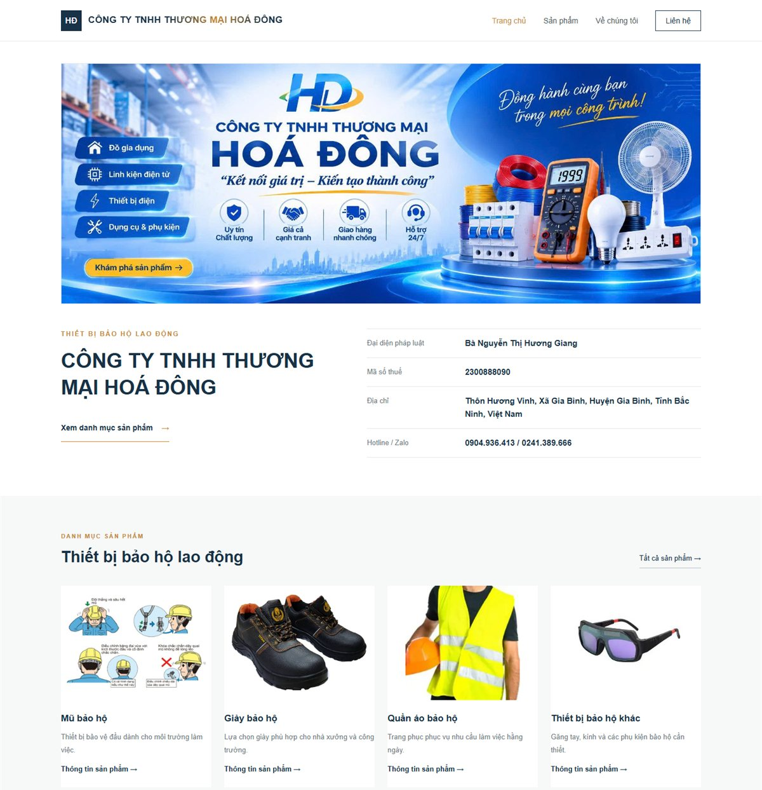</td>
    <td valign="top"></td>
  </tr>
</table>

### Các trang

| Trang | Đường dẫn | Nội dung |
|---|---|---|
| Trang chủ | [`index.html`](https://cty-tthhtm-hoa-dong.github.io/GioiThieuCty/) | Banner, thông tin doanh nghiệp, nhóm thiết bị bảo hộ, bài viết |
| Sản phẩm | [`products.html`](https://cty-tthhtm-hoa-dong.github.io/GioiThieuCty/products.html) | 46 sản phẩm, lọc theo hạng mục và tìm kiếm |
| Về chúng tôi | [`about.html`](https://cty-tthhtm-hoa-dong.github.io/GioiThieuCty/about.html) | Giới thiệu doanh nghiệp |
| Liên hệ | [`contact.html`](https://cty-tthhtm-hoa-dong.github.io/GioiThieuCty/contact.html) | Thông tin liên hệ |
| Bài viết (11 bài) | `bai-viet-*.html` | Mỗi bài một trang riêng, xem danh sách ở mục Bài viết |

## Sản phẩm

### Thiết bị bảo hộ lao động (4)

<table>
  <tr>
    <td align="center" valign="top" width="25%">
      <br>
      <sub>Bộ trang thiết bị bảo hộ lao động cá nhân (PPE)</sub>
    </td>
    <td align="center" valign="top" width="25%">
      <br>
      <sub>Mũ bảo hộ lao động / Nón bảo hộ công nghiệp</sub>
    </td>
    <td align="center" valign="top" width="25%">
      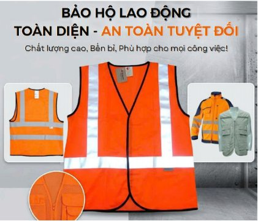<br>
      <sub>Áo bảo hộ lao động / Áo gi lê phản quang bảo hộ</sub>
    </td>
    <td align="center" valign="top" width="25%">
      <br>
      <sub>Găng tay bảo hộ lao động / Găng tay sợi dệt kim phủ hạt nhựa</sub>
    </td>
  </tr>
</table>

### Dụng cụ đo & kiểm tra (13)

<table>
  <tr>
    <td align="center" valign="top" width="25%">
      <br>
      <sub>Thước đo gen (Bộ chốt đo chuẩn)</sub>
    </td>
    <td align="center" valign="top" width="25%">
      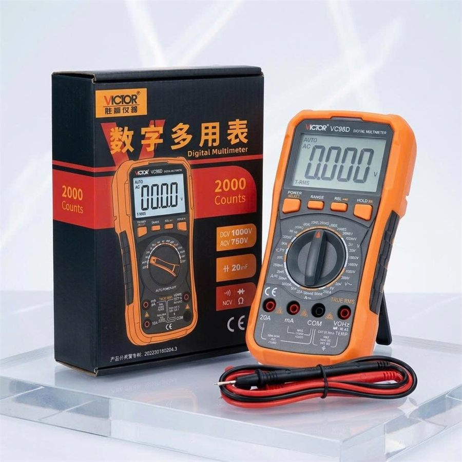<br>
      <sub>Đồng hồ vạn năng kỹ thuật số VICTOR VC890D</sub>
    </td>
    <td align="center" valign="top" width="25%">
      <br>
      <sub>Máy dò dây cáp mạng / Thiết bị kiểm tra dây cáp</sub>
    </td>
    <td align="center" valign="top" width="25%">
      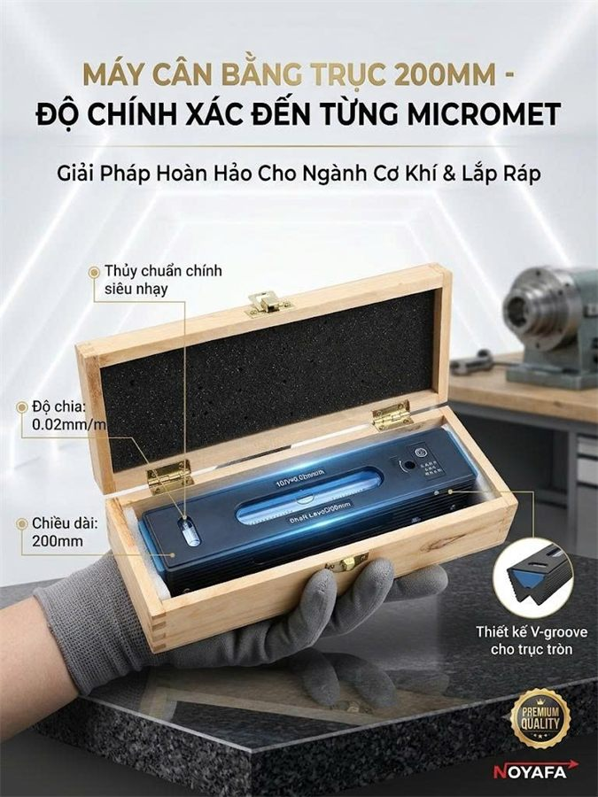<br>
      <sub>Máy cân bằng trục 200mm (Thủy chuẩn cơ khí chính xác)</sub>
    </td>
  </tr>
  <tr>
    <td align="center" valign="top" width="25%">
      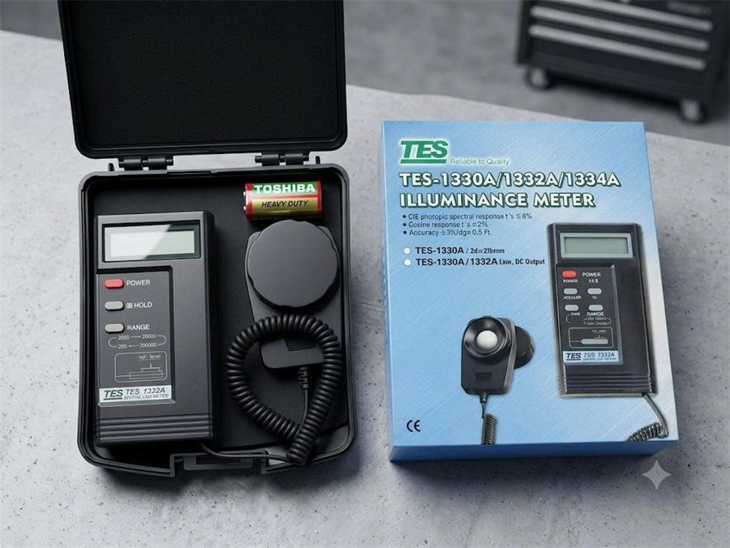<br>
      <sub>Máy đo ánh sáng kỹ thuật số TES-1332A</sub>
    </td>
    <td align="center" valign="top" width="25%">
      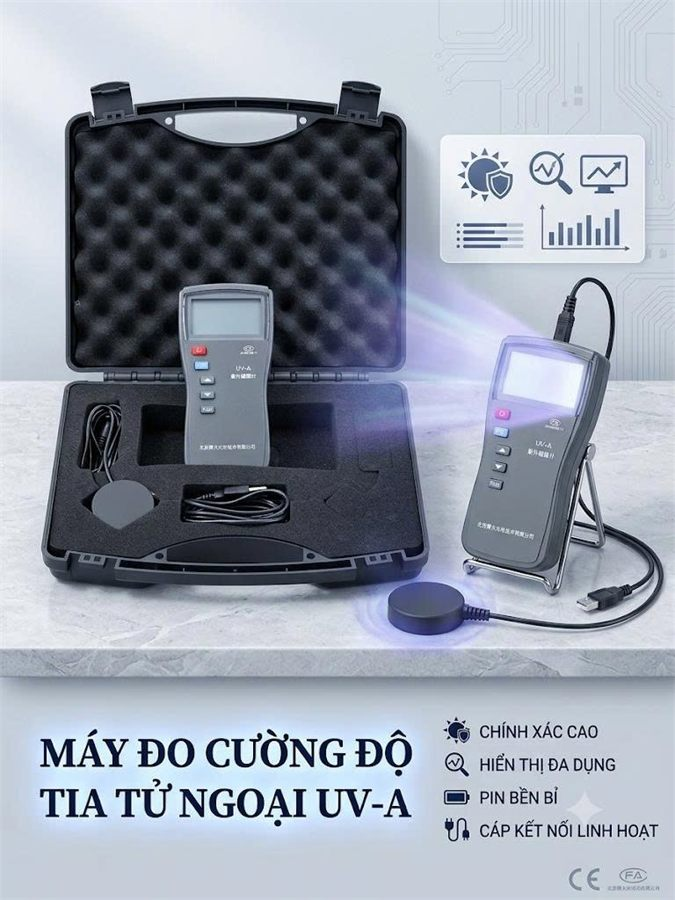<br>
      <sub>Máy đo cường độ tia tử ngoại UV-A</sub>
    </td>
    <td align="center" valign="top" width="25%">
      <br>
      <sub>Thước dây sợi thủy tinh 20m (Thước cuộn vải đo khoảng cách)</sub>
    </td>
    <td align="center" valign="top" width="25%">
      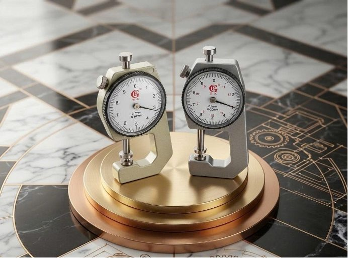<br>
      <sub>Thước đo độ dày cơ khí (đồng hồ đo độ dày)</sub>
    </td>
  </tr>
  <tr>
    <td align="center" valign="top" width="25%">
      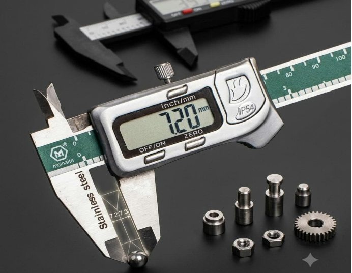<br>
      <sub>Thước kẹp điện tử / Thước cặp kỹ thuật số</sub>
    </td>
    <td align="center" valign="top" width="25%">
      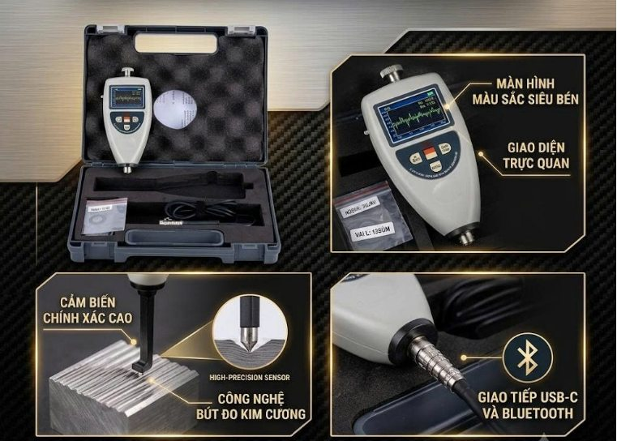<br>
      <sub>Máy đo độ nhám bề mặt điện tử</sub>
    </td>
    <td align="center" valign="top" width="25%">
      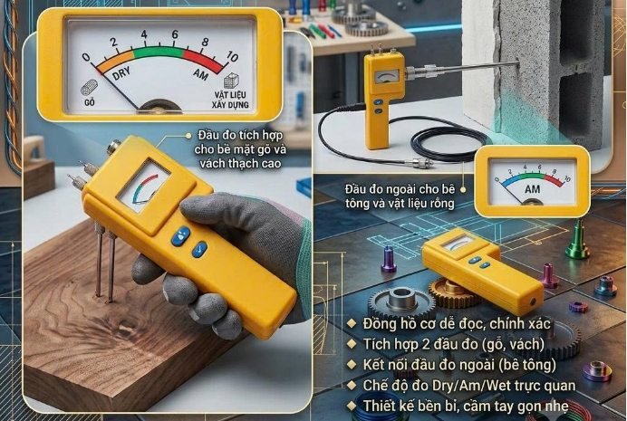<br>
      <sub>Máy đo độ ẩm gỗ và vật liệu xây dựng (kim nén)</sub>
    </td>
    <td align="center" valign="top" width="25%">
      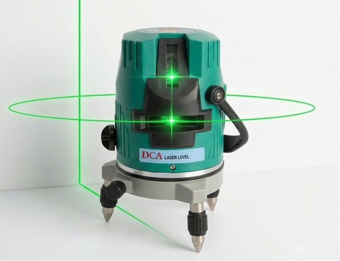<br>
      <sub>Máy cân mực laser 3 tia xanh</sub>
    </td>
  </tr>
  <tr>
    <td align="center" valign="top" width="25%">
      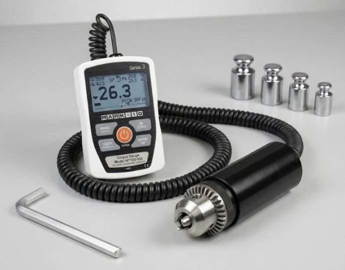<br>
      <sub>Máy đo lực siết kỹ thuật số Mark-10 / Thiết bị đo mô-men xoắn MMT03-100</sub>
    </td>
  </tr>
</table>

### Thiết bị điện & tự động hóa (5)

<table>
  <tr>
    <td align="center" valign="top" width="25%">
      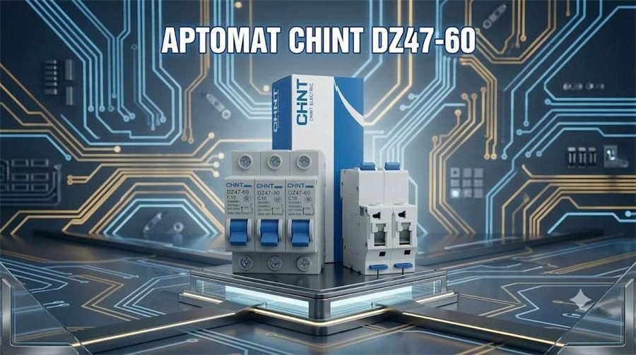<br>
      <sub>Aptomat CHINT DZ47-60 (Cầu dao tự động dạng tép MCB)</sub>
    </td>
    <td align="center" valign="top" width="25%">
      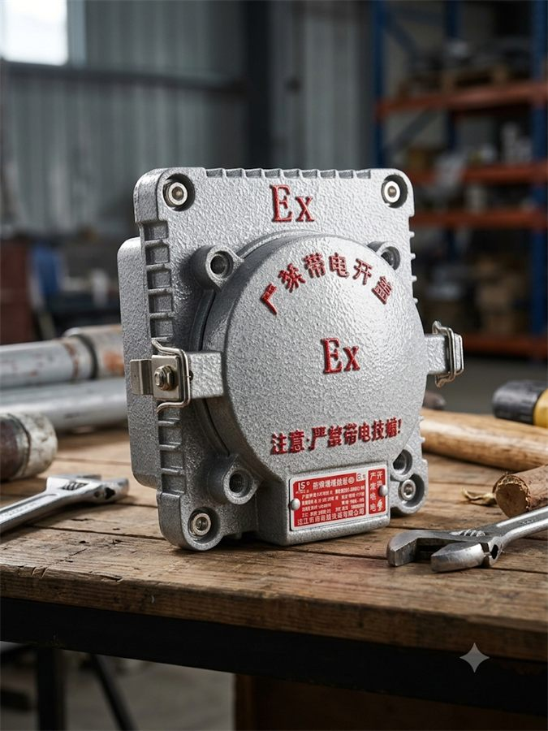<br>
      <sub>Hộp ổ cắm chống cháy nổ (Ổ cắm công nghiệp phòng nổ Ex)</sub>
    </td>
    <td align="center" valign="top" width="25%">
      <br>
      <sub>Mạch điều khiển truyền thông RS485 / Bo mạch IO Modbus RTU</sub>
    </td>
    <td align="center" valign="top" width="25%">
      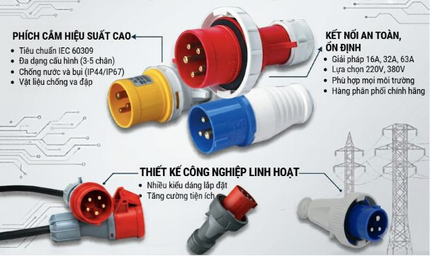<br>
      <sub>Phích cắm và ổ cắm công nghiệp CEE</sub>
    </td>
  </tr>
  <tr>
    <td align="center" valign="top" width="25%">
      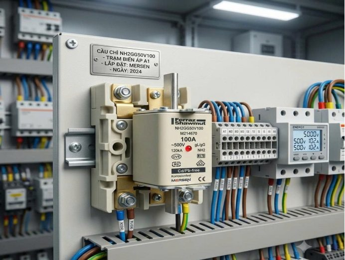<br>
      <sub>Cầu chì công nghiệp hạ thế / Cầu chì dao NH2 100A 500V</sub>
    </td>
  </tr>
</table>

### Dụng cụ gia công cơ khí (4)

<table>
  <tr>
    <td align="center" valign="top" width="25%">
      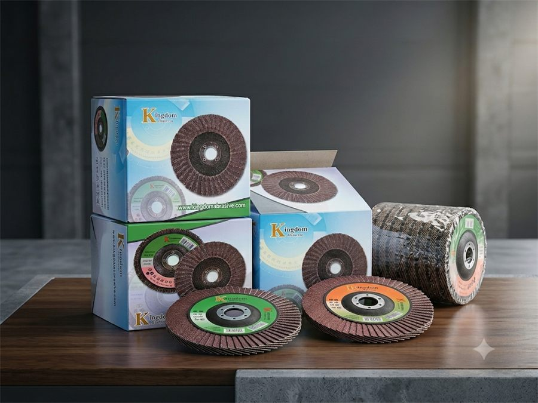<br>
      <sub>Đá nhám xếp / Đĩa nhám xếp (Chén nhám xếp)</sub>
    </td>
    <td align="center" valign="top" width="25%">
      <br>
      <sub>Khuôn dập nóng đồng thau vuông có 4 chốt định vị</sub>
    </td>
    <td align="center" valign="top" width="25%">
      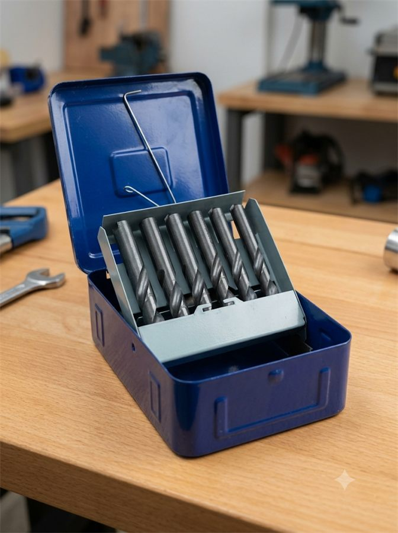<br>
      <sub>Bộ mũi khoan thép gió HSS (Hộp sắt)</sub>
    </td>
    <td align="center" valign="top" width="25%">
      <br>
      <sub>Chụp khí súng hàn MIG 15AK BAO HU ZUI (Hộp 5 cái)</sub>
    </td>
  </tr>
</table>

### Vật tư công nghiệp (5)

<table>
  <tr>
    <td align="center" valign="top" width="25%">
      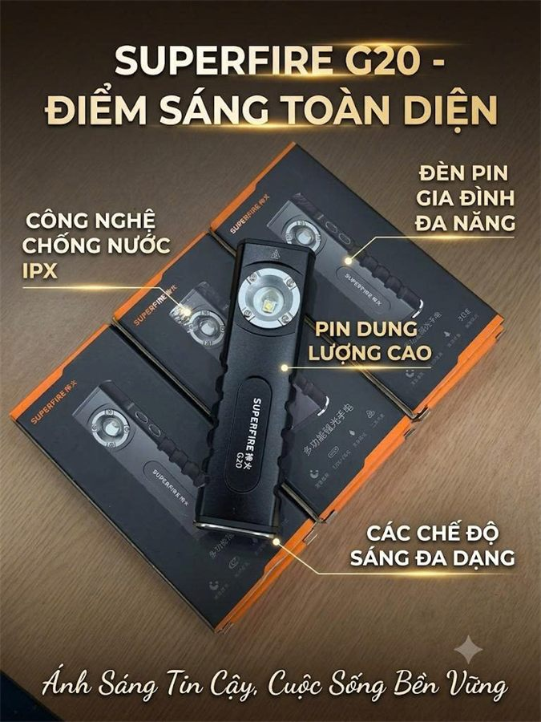<br>
      <sub>Đèn pin siêu sáng đa năng SUPERFIRE G20</sub>
    </td>
    <td align="center" valign="top" width="25%">
      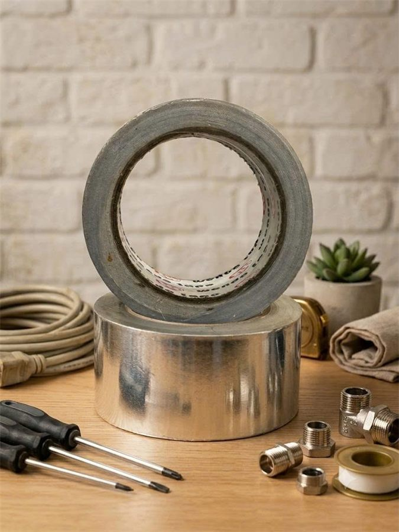<br>
      <sub>Băng keo vải chịu lực &amp; Băng keo nhôm cách nhiệt</sub>
    </td>
    <td align="center" valign="top" width="25%">
      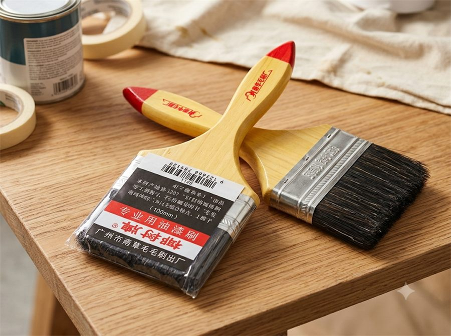<br>
      <sub>Chổi quét sơn cán gỗ 4 inch (100mm) – Cọ sơn hiệu Cây Dừa</sub>
    </td>
    <td align="center" valign="top" width="25%">
      <br>
      <sub>Bu lông móc cẩu M30 mạ kẽm 3.6 tấn (DIN 580)</sub>
    </td>
  </tr>
  <tr>
    <td align="center" valign="top" width="25%">
      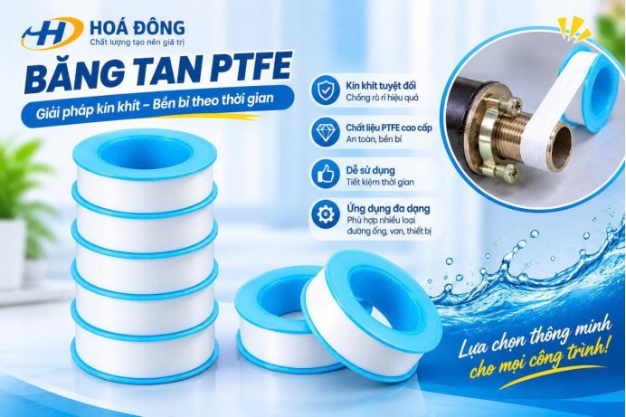<br>
      <sub>Băng tan PTFE</sub>
    </td>
  </tr>
</table>

### Dụng cụ cầm tay (5)

<table>
  <tr>
    <td align="center" valign="top" width="25%">
      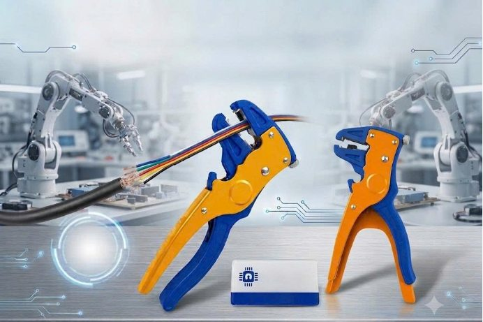<br>
      <sub>Kìm tuốt dây điện tự động</sub>
    </td>
    <td align="center" valign="top" width="25%">
      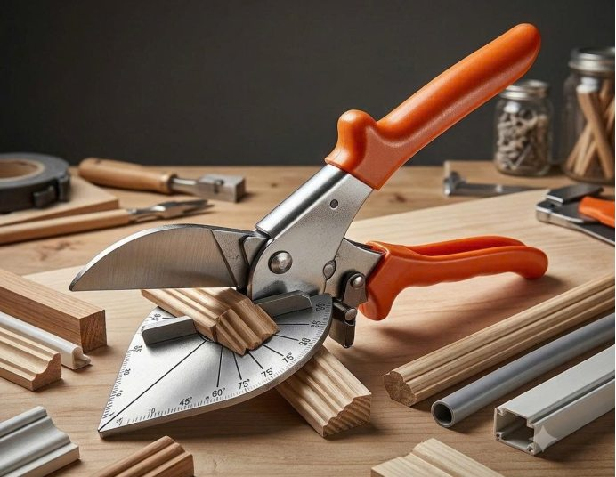<br>
      <sub>Kìm cắt góc đa năng / Kìm cắt phào nẹp góc</sub>
    </td>
    <td align="center" valign="top" width="25%">
      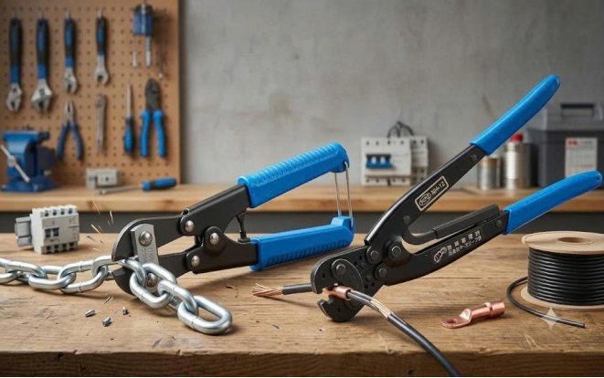<br>
      <sub>Kìm cắt cáp cộng lực / Kìm bấm cos thủy lực cầm tay</sub>
    </td>
    <td align="center" valign="top" width="25%">
      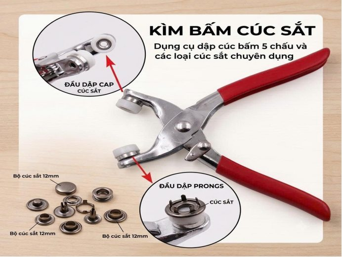<br>
      <sub>Kìm bấm cúc sắt / Kìm dập cúc 5 chấu</sub>
    </td>
  </tr>
  <tr>
    <td align="center" valign="top" width="25%">
      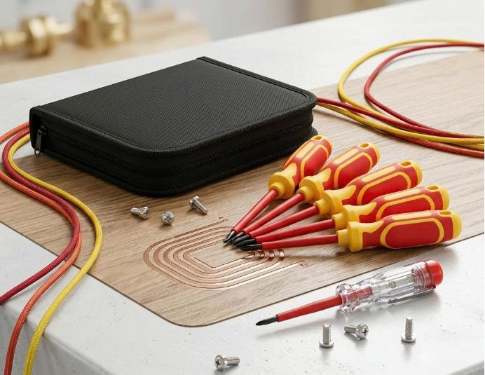<br>
      <sub>Bộ tua vít cách điện 1000V thợ điện (7 chi tiết, có bút thử điện)</sub>
    </td>
  </tr>
</table>

### Máy khoan, máy cắt & máy hàn (7)

<table>
  <tr>
    <td align="center" valign="top" width="25%">
      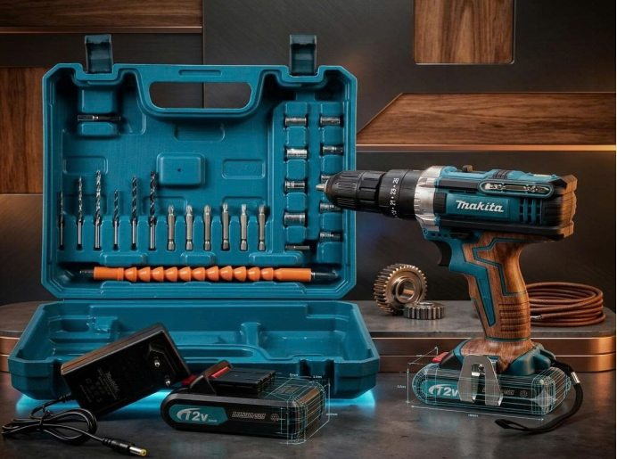<br>
      <sub>Bộ máy khoan pin cầm tay 72V</sub>
    </td>
    <td align="center" valign="top" width="25%">
      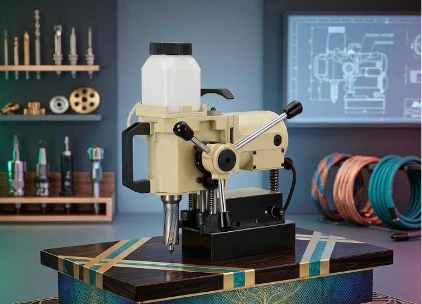<br>
      <sub>Máy khoan từ mini nằm ngang Tsyr Tzun FM-35A</sub>
    </td>
    <td align="center" valign="top" width="25%">
      <br>
      <sub>Máy khoan động lực NIKAWA NK-ID38</sub>
    </td>
    <td align="center" valign="top" width="25%">
      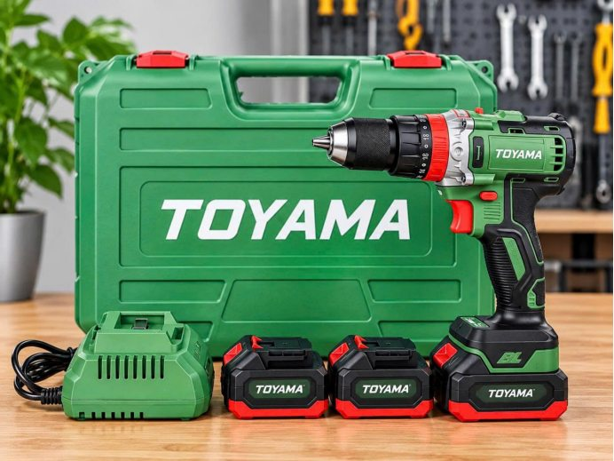<br>
      <sub>Bộ máy khoan pin không dây TOYAMA (động cơ không chổi than)</sub>
    </td>
  </tr>
  <tr>
    <td align="center" valign="top" width="25%">
      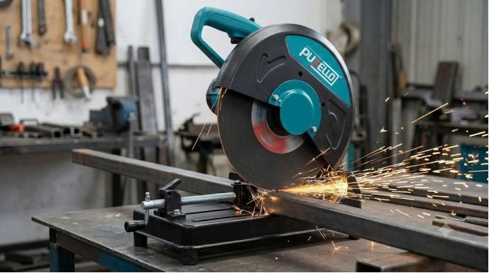<br>
      <sub>Máy cắt sắt bàn công nghiệp / Máy cắt kim loại đĩa đá 355mm</sub>
    </td>
    <td align="center" valign="top" width="25%">
      <br>
      <sub>Máy cắt gạch đá cầm tay / Máy cắt bê tông, gạch men DCA</sub>
    </td>
    <td align="center" valign="top" width="25%">
      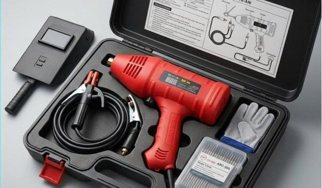<br>
      <sub>Máy hàn que cầm tay Phi-an / Máy hàn điện tử mini ARC-200</sub>
    </td>
  </tr>
</table>

### Đèn chiếu sáng (3)

<table>
  <tr>
    <td align="center" valign="top" width="25%">
      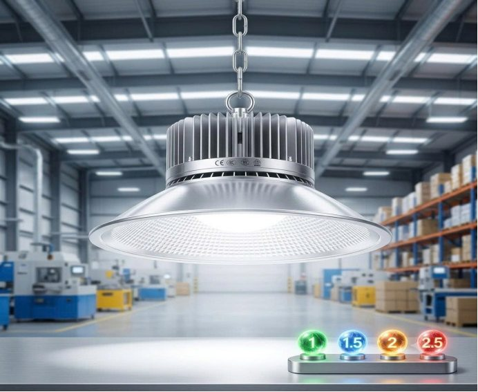<br>
      <sub>Đèn LED nhà xưởng / Đèn Highbay LED (100W - 250W)</sub>
    </td>
    <td align="center" valign="top" width="25%">
      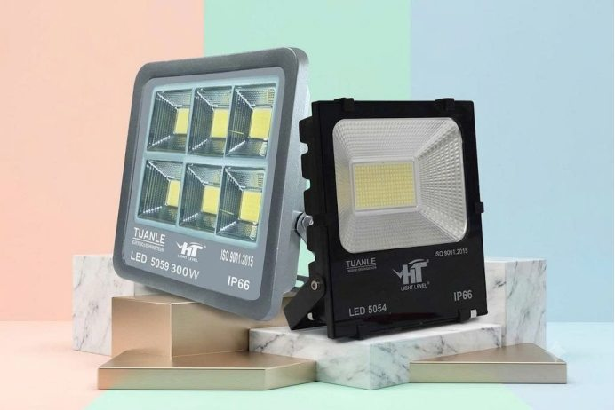<br>
      <sub>Đèn LED pha ngoài trời / Đèn pha LED cao áp IP66 (100W - 300W)</sub>
    </td>
    <td align="center" valign="top" width="25%">
      <br>
      <sub>Đèn LED tích điện treo móc (đèn búp sạc)</sub>
    </td>
  </tr>
</table>

## Bài viết

Mỗi bài viết có link riêng. Bấm nút **“Sao chép link”** trên website để lấy link gửi qua Zalo, Facebook, Messenger; khi dán link sẽ hiện ảnh, tiêu đề và mô tả xem trước.

<table>
  <tr>
    <td width="33%" valign="top">
      <a href="https://cty-tthhtm-hoa-dong.github.io/GioiThieuCty/bai-viet-toi-uu-chuoi-cung-ung-mro.html"></a><br>
      <b><a href="https://cty-tthhtm-hoa-dong.github.io/GioiThieuCty/bai-viet-toi-uu-chuoi-cung-ung-mro.html">Giải mã bài toán tối ưu chuỗi cung ứng MRO cho các doanh nghiệp công nghiệp Việt Nam</a></b><br>
      <sub>Thực hiện: Phạm Thị Thuỳ Linh</sub>
    </td>
    <td width="33%" valign="top">
      <a href="https://cty-tthhtm-hoa-dong.github.io/GioiThieuCty/bai-viet-thiet-bi-bao-ho-lao-dong.html"></a><br>
      <b><a href="https://cty-tthhtm-hoa-dong.github.io/GioiThieuCty/bai-viet-thiet-bi-bao-ho-lao-dong.html">Thiết bị bảo hộ lao động: Yêu cầu thiết yếu trong môi trường sản xuất</a></b><br>
      <sub>Thực hiện: Mai Thị Thảo</sub>
    </td>
    <td width="33%" valign="top">
      <a href="https://cty-tthhtm-hoa-dong.github.io/GioiThieuCty/bai-viet-van-hanh-may-cat-ban.html"></a><br>
      <b><a href="https://cty-tthhtm-hoa-dong.github.io/GioiThieuCty/bai-viet-van-hanh-may-cat-ban.html">Kỹ thuật vận hành máy cắt bàn an toàn và chính xác trong xưởng gia công</a></b><br>
      <sub>Thực hiện: Phạm Thị Thùy Linh</sub>
    </td>
  </tr>
  <tr>
    <td width="33%" valign="top">
      <a href="https://cty-tthhtm-hoa-dong.github.io/GioiThieuCty/bai-viet-may-mai-dung-cu-co-khi.html"></a><br>
      <b><a href="https://cty-tthhtm-hoa-dong.github.io/GioiThieuCty/bai-viet-may-mai-dung-cu-co-khi.html">Máy mài và dụng cụ cơ khí trong hoạt động sản xuất</a></b><br>
      <sub>Thực hiện: Mai Thị Thảo</sub>
    </td>
    <td width="33%" valign="top">
      <a href="https://cty-tthhtm-hoa-dong.github.io/GioiThieuCty/bai-viet-5-sai-lam-chon-thiet-bi-bao-ho.html"></a><br>
      <b><a href="https://cty-tthhtm-hoa-dong.github.io/GioiThieuCty/bai-viet-5-sai-lam-chon-thiet-bi-bao-ho.html">5 sai lầm thường gặp khi lựa chọn thiết bị bảo hộ lao động</a></b><br>
      <sub>Thực hiện: Mai Thị Thảo, Phạm Thị Thuỳ Linh</sub>
    </td>
    <td width="33%" valign="top">
      <a href="https://cty-tthhtm-hoa-dong.github.io/GioiThieuCty/bai-viet-canh-bao-lay-vat-mac-ket-trong-may.html"></a><br>
      <b><a href="https://cty-tthhtm-hoa-dong.github.io/GioiThieuCty/bai-viet-canh-bao-lay-vat-mac-ket-trong-may.html">Cảnh báo nguy cơ tai nạn khi lấy vật mắc kẹt trong máy đang vận hành</a></b><br>
      <sub>Thực hiện: Thu Hà, Mai Thảo, Thùy Linh</sub>
    </td>
  </tr>
  <tr>
    <td width="33%" valign="top">
      <a href="https://cty-tthhtm-hoa-dong.github.io/GioiThieuCty/bai-viet-an-toan-lao-dong-xay-dung.html"></a><br>
      <b><a href="https://cty-tthhtm-hoa-dong.github.io/GioiThieuCty/bai-viet-an-toan-lao-dong-xay-dung.html">An toàn lao động – Yêu cầu cấp thiết trong hoạt động xây dựng</a></b><br>
      <sub>Thực hiện: Thu Hà, Thùy Linh, Mai Thảo</sub>
    </td>
    <td width="33%" valign="top">
      <a href="https://cty-tthhtm-hoa-dong.github.io/GioiThieuCty/bai-viet-hoa-dong-dong-hanh-an-toan-lao-dong.html"></a><br>
      <b><a href="https://cty-tthhtm-hoa-dong.github.io/GioiThieuCty/bai-viet-hoa-dong-dong-hanh-an-toan-lao-dong.html">Hóa Đông – Đồng hành cùng doanh nghiệp trong hành trình nâng cao an toàn lao động</a></b><br>
      <sub>Thực hiện: Thùy Linh, Mai Thảo</sub>
    </td>
    <td width="33%" valign="top">
      <a href="https://cty-tthhtm-hoa-dong.github.io/GioiThieuCty/bai-viet-thiet-bi-do-ap-suat-cong-nghiep.html"></a><br>
      <b><a href="https://cty-tthhtm-hoa-dong.github.io/GioiThieuCty/bai-viet-thiet-bi-do-ap-suat-cong-nghiep.html">Thiết bị đo áp suất công nghiệp – Yếu tố quan trọng trong kiểm soát vận hành nhà máy</a></b><br>
      <sub>Thực hiện: Thu Hà</sub>
    </td>
  </tr>
  <tr>
    <td width="33%" valign="top">
      <a href="https://cty-tthhtm-hoa-dong.github.io/GioiThieuCty/bai-viet-xu-ly-khi-nguon-dien-bi-chap.html"></a><br>
      <b><a href="https://cty-tthhtm-hoa-dong.github.io/GioiThieuCty/bai-viet-xu-ly-khi-nguon-dien-bi-chap.html">Cách xử lý khi nguồn điện bị chập: Những điều người lao động cần biết</a></b><br>
      <sub>Thực hiện: Thu Hà</sub>
    </td>
    <td width="33%" valign="top">
      <a href="https://cty-tthhtm-hoa-dong.github.io/GioiThieuCty/bai-viet-quy-trinh-kiem-tra-an-toan-dau-ca.html"></a><br>
      <b><a href="https://cty-tthhtm-hoa-dong.github.io/GioiThieuCty/bai-viet-quy-trinh-kiem-tra-an-toan-dau-ca.html">Quy trình kiểm tra an toàn trước mỗi ca làm việc trong nhà máy, xưởng sản xuất</a></b><br>
      <sub>Thực hiện: Thu Hà</sub>
    </td>
  </tr>
</table>

## Chạy thử trên máy

Website là HTML/CSS/JavaScript thuần, không cần cài đặt thêm. Dữ liệu sản phẩm được tải từ file JSON nên cần chạy qua máy chủ HTTP (mở trực tiếp file `index.html` sẽ không tải được sản phẩm):

```bash
git clone https://github.com/cty-tthhtm-hoa-dong/GioiThieuCty.git
cd GioiThieuCty
python -m http.server 8000
```

Sau đó mở <http://localhost:8000/>. Nếu trình duyệt vẫn hiện giao diện cũ, bấm **Ctrl + F5**.

## Cấu trúc thư mục

```text
├── index.html                                 Trang chủ
├── products.html                              Trang sản phẩm (dữ liệu từ data/)
├── about.html                                 Về chúng tôi
├── contact.html                               Liên hệ
├── bai-viet-toi-uu-chuoi-cung-ung-mro.html    Bài viết: chuỗi cung ứng MRO
├── bai-viet-thiet-bi-bao-ho-lao-dong.html     Bài viết: thiết bị bảo hộ lao động
├── components/navbar.html                     Thanh menu dùng chung cho mọi trang
├── css/style.css                              Toàn bộ giao diện
├── js/main.js                                 Tải menu, ảnh tự chuyển, nút sao chép link
├── js/products.js                             Hiển thị, lọc và tìm kiếm sản phẩm
├── data/products.json                         Danh sách sản phẩm
├── data/categories.json                       Danh sách hạng mục
├── images/products/                           Ảnh sản phẩm
├── images/home/                               Banner và ảnh trang chủ
├── images/articles/                           Ảnh trong bài viết
└── docs/                                      Ảnh chụp giao diện cho README
```

## Cập nhật nội dung

### Thêm hoặc sửa sản phẩm

1. Chép ảnh sản phẩm vào `images/products/` (nên dùng JPG, cạnh dài khoảng 900px).
2. Thêm một mục vào `data/products.json`:

   ```json
   {
       "id": "ma-san-pham",
       "name": "Tên sản phẩm",
       "nameEn": "English name",
       "nameZh": "中文名称",
       "categoryId": "measuring-tools",
       "description": "Mô tả ngắn hiển thị trên thẻ sản phẩm.",
       "image": "images/products/ma-san-pham.jpg",
       "price": "",
       "featured": false
   }
   ```

   `categoryId` phải trùng với một `id` trong `data/categories.json`. Để trống `price` thì website hiện “Liên hệ báo giá”.

### Thêm bài viết

1. Chép một file bài viết có sẵn (ví dụ `bai-viet-thiet-bi-bao-ho-lao-dong.html`) thành file mới, đặt tên không dấu, nối bằng dấu gạch ngang.
2. Sửa tiêu đề, nội dung, ảnh và các thẻ `og:` trong phần `<head>` (để link hiện xem trước đúng khi chia sẻ).
3. Sửa `data-copy-link` của nút “Sao chép link” thành tên file mới.
4. Thêm thẻ bài viết vào mục **Bài viết** trong `index.html`.

### Đưa thay đổi lên website

Website chạy trên GitHub Pages từ nhánh `main`. Sau khi đẩy code lên, khoảng 1-2 phút sau website sẽ cập nhật.

```bash
git add .
git commit -m "Mô tả thay đổi"
git push origin main
```

---

<p align="center">
  <sub>© 2026 Công ty TNHH Thương mại Hoá Đông · Thôn Hương Vinh, Xã Gia Bình, Huyện Gia Bình, Tỉnh Bắc Ninh</sub>
</p>
